<p align="center">
  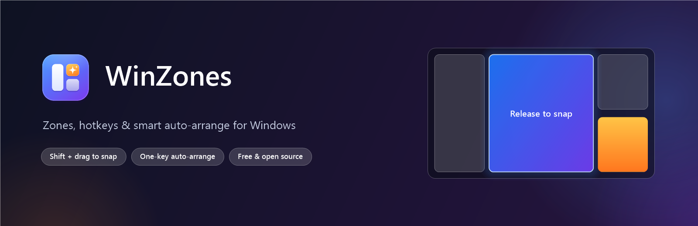
</p>

<p align="center">
  <a href="https://github.com/Coursion-Studio/WinZones/releases/latest"></a>
  <a href="https://github.com/Coursion-Studio/WinZones/releases"></a>
  
  
  <a href="LICENSE"></a>
</p>

<p align="center">
  <b>A tiny, fast, free window manager for Windows.</b><br>
  Hold <kbd>Shift</kbd> while dragging a window to snap it into a zone,<br>
  or press <kbd>Win</kbd>+<kbd>Alt</kbd>+<kbd>A</kbd> and let WinZones arrange <i>everything</i> for you.
</p>

<p align="center">
  <a href="https://github.com/Coursion-Studio/WinZones/releases/latest"><b>⬇ Download WinZones</b></a>
  &nbsp;·&nbsp; <a href="#-features">Features</a>
  &nbsp;·&nbsp; <a href="#%EF%B8%8F-shortcuts">Shortcuts</a>
  &nbsp;·&nbsp; <a href="#-how-smart-arrange-works">Smart arrange</a>
  &nbsp;·&nbsp; <a href="#-faq">FAQ</a>
</p>

---

<p align="center">
  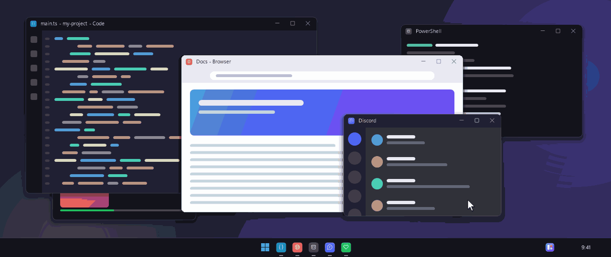
  <br><sub><b>See it in action:</b> Shift + drag to snap, drop on the pill to auto-arrange every window, and right-click the tray for the command menu.</sub>
</p>

<p align="center">
  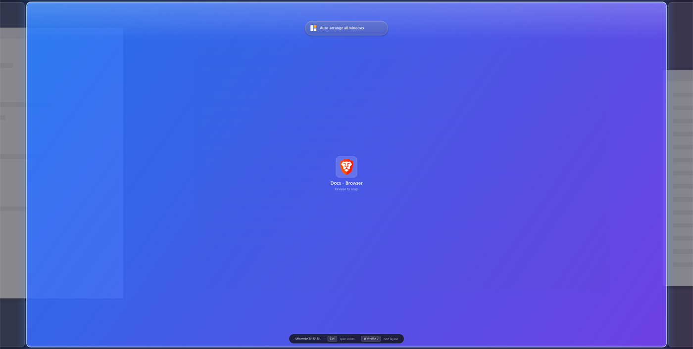
  <br><sub>Up close: zones fade in, the highlight follows your mouse and shows which window lands where.</sub>
</p>

## ✨ Features

|   |   |
|---|---|
| 🧲 **Drag-to-snap zones** | Hold <kbd>Shift</kbd> while dragging any window. A frosted-glass overlay shows your zones; drop to snap. Add <kbd>Ctrl</kbd> to span several zones. |
| 🪄 **Smart auto-arrange** | One key (or drop a window on the orange pill) tiles **all** open windows. Editors and browsers get big columns; chat, music and terminals are stacked at the sides. |
| 📐 **Your own layouts** | A visual editor lets you draw any layout. Each monitor remembers its own layout. Ultrawide, 16:9 and portrait presets are built in. |
| ⌨️ **Global shortcuts** | Snap to zone 1–9, cycle zones, switch layouts, fill, center, move to the next monitor, undo. Every shortcut can be rebound. |
| ⚡ **Command menu** | Right-click the tray icon for a Raycast-style palette: type to filter layouts and commands, then use the arrow keys and <kbd>Enter</kbd>. |
| 🎞️ **Smooth, but light** | Windows glide into place, and the overlay fades and cross-fades. Only small layers are redrawn, so it stays smooth even on 5K ultrawides. |
| ↩️ **Undo** | <kbd>Win</kbd>+<kbd>Alt</kbd>+<kbd>Z</kbd> puts windows back where they were, and you can undo several steps. |
| 🪶 **Tiny & private** | A single ~280 KB exe with no installer, no runtime to download, no telemetry and no internet access. Portable mode is built in. |

## 📸 Screenshots

<table>
  <tr>
    <td width="50%" align="center">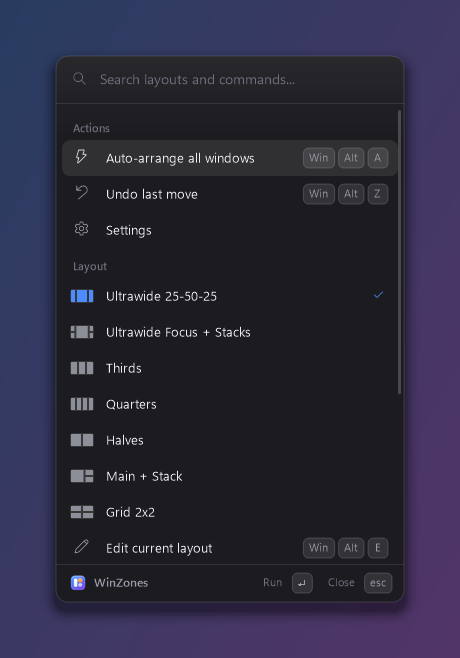<br><sub><b>Right-click the tray icon:</b> a command menu with layouts, shortcuts and toggles.</sub></td>
    <td width="50%" align="center">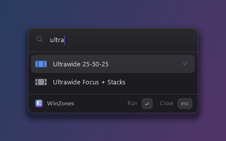<br><sub><b>Just type</b> to filter, then press <kbd>Enter</kbd>.</sub><br><br>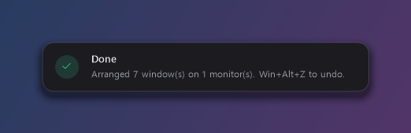<br><sub>Quiet toasts instead of Windows balloon tips.</sub></td>
  </tr>
</table>

<table>
  <tr>
    <td width="50%"><br><sub><b>Drop on the pill</b> to auto-arrange every window.</sub></td>
    <td width="50%">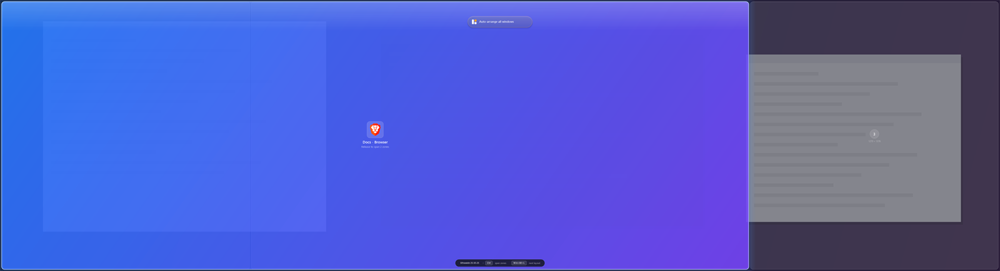<br><sub><b>Shift + Ctrl</b> spans a window across zones.</sub></td>
  </tr>
  <tr>
    <td>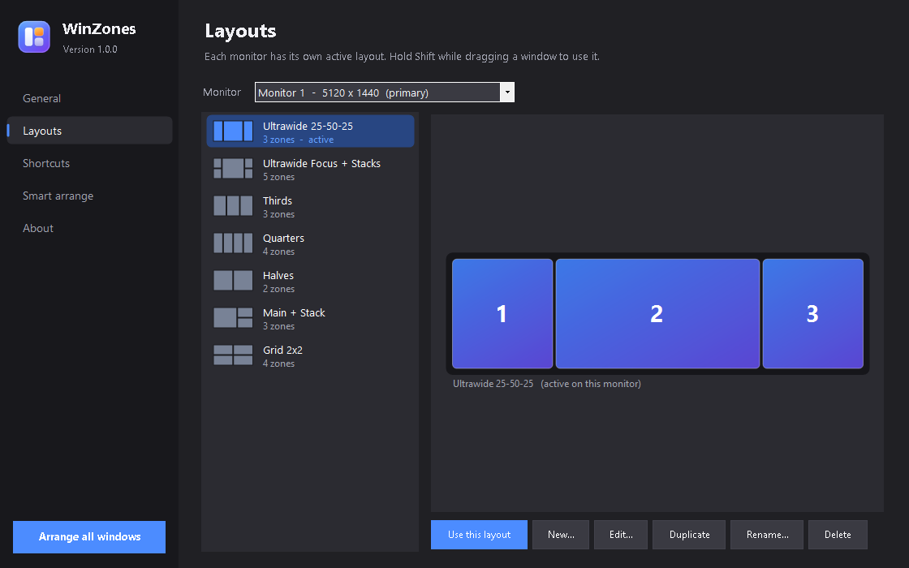<br><sub>Pick or create a layout for each monitor.</sub></td>
    <td>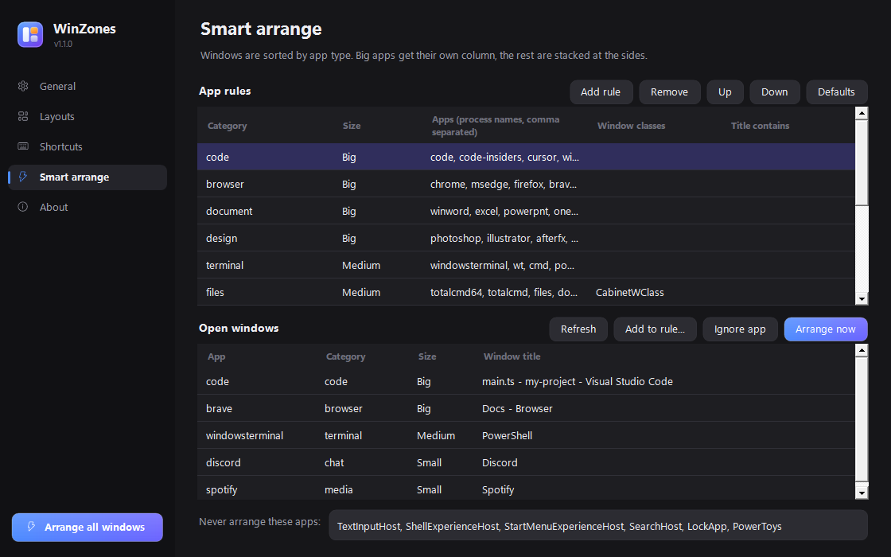<br><sub>Teach smart arrange about your apps.</sub></td>
  </tr>
  <tr>
    <td>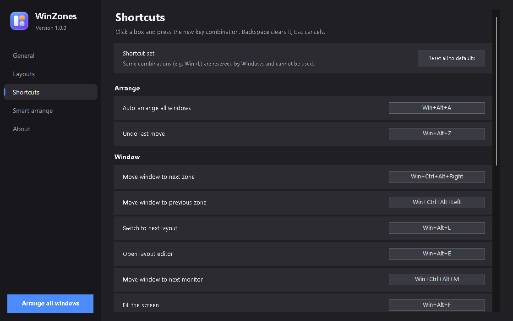<br><sub>Rebind any shortcut by pressing the keys you want.</sub></td>
    <td>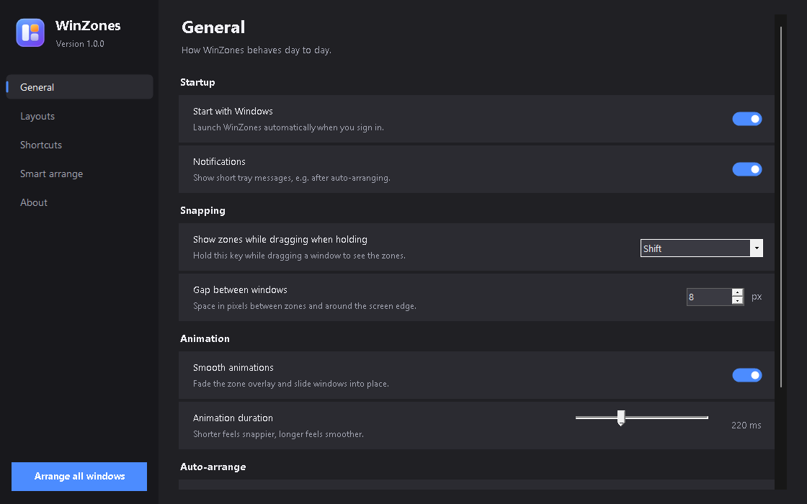<br><sub>Gap size, animation speed, start with Windows…</sub></td>
  </tr>
</table>

## 🚀 Install

1. Download **`WinZones-x.y.z-win.zip`** from the [latest release](https://github.com/Coursion-Studio/WinZones/releases/latest).
2. Extract it anywhere, for example `C:\Tools\WinZones`.
3. Run **`WinZones.exe`**. Settings open on first launch, and WinZones lives in the system tray.
4. Optional: turn on **Settings → General → Start with Windows**.

> **"Windows protected your PC"?** You may see this SmartScreen warning because the exe isn't code-signed yet, which is common for new free apps. Click **More info → Run anyway**. Each release ships with a `.sha256` file if you want to verify the download.

**Requirements:** Windows 10 (1903+) or Windows 11. .NET Framework 4.8 is required and is already part of Windows, so there's nothing extra to install.

## ⌨️ Shortcuts

| Action | Default |
|---|---|
| Snap while dragging | Hold <kbd>Shift</kbd> while dragging a window |
| Span several zones | <kbd>Shift</kbd> + <kbd>Ctrl</kbd> while dragging |
| **Auto-arrange all windows** | <kbd>Win</kbd>+<kbd>Alt</kbd>+<kbd>A</kbd> · drop on the pill · double-click the tray icon |
| Undo last move/arrange | <kbd>Win</kbd>+<kbd>Alt</kbd>+<kbd>Z</kbd> |
| Snap to zone 1–9 | <kbd>Win</kbd>+<kbd>Ctrl</kbd>+<kbd>Alt</kbd>+<kbd>1</kbd>…<kbd>9</kbd> |
| Next / previous zone | <kbd>Win</kbd>+<kbd>Ctrl</kbd>+<kbd>Alt</kbd>+<kbd>→</kbd> / <kbd>←</kbd> |
| Switch layout | <kbd>Win</kbd>+<kbd>Alt</kbd>+<kbd>L</kbd> |
| Layout editor | <kbd>Win</kbd>+<kbd>Alt</kbd>+<kbd>E</kbd> |
| Fill screen / center | <kbd>Win</kbd>+<kbd>Alt</kbd>+<kbd>F</kbd> / <kbd>Win</kbd>+<kbd>Alt</kbd>+<kbd>C</kbd> |
| Move to next monitor | <kbd>Win</kbd>+<kbd>Ctrl</kbd>+<kbd>Alt</kbd>+<kbd>M</kbd> |
| Settings | Click the tray icon, or start `WinZones.exe` again |
| Command menu | Right-click the tray icon, then type to filter |

To change a shortcut, go to **Settings → Shortcuts**, click a box and press the new keys. If another app already uses a combination, WinZones shows *"In use by another app"*.

### Layout editor

| Key | Action |
|---|---|
| Drag | Draw a zone |
| Right-click / <kbd>Del</kbd> | Remove zone |
| <kbd>V</kbd> / <kbd>H</kbd> | Split the zone under the mouse into columns / rows |
| <kbd>1</kbd>–<kbd>6</kbd> | Start from N equal columns |
| <kbd>G</kbd> · hold <kbd>Shift</kbd> | Change grid snap (10/5/2.5/1 %) · fine 1 % snap |
| <kbd>Enter</kbd> / <kbd>Esc</kbd> | Save / cancel |

## 🧠 How smart arrange works

1. **Collect.** It takes every real app window: visible, resizable, titled, and on the current virtual desktop.
2. **Classify.** It decides what each window is, using editable rules:

   | Size | Apps (defaults) |
   |---|---|
   | **Big** | code editors & IDEs, browsers, Office/PDF/notes, design tools |
   | **Medium** | terminals, file managers, mail, AI assistants, unknown apps |
   | **Small** | chat, music & video, game launchers, utilities |

3. **Distribute.** With several monitors, it spreads windows by load and screen size. The window you're working in stays put, and windows of the same kind stay together.
4. **Tile.** It sets columns by aspect ratio: up to 4 on 32:9, 3 on 21:9, 2 on 16:9, and rows on portrait screens. The **focused window gets the widest column in the middle**, other big apps get their own columns, and everything else is stacked at the sides.

Not happy with a choice? **Settings → Smart arrange** lists your open windows and how each is classified. Add an app to a rule, or ignore it, with one click.

## ❓ FAQ

<details>
<summary><b>How is this different from PowerToys FancyZones?</b></summary>

WinZones is a single small exe focused only on window layout, with no other suite tools. It adds **smart auto-arrange** (tile everything by app type with one key), a live window preview inside the zone you're about to drop on, and multi-level undo.
</details>

<details>
<summary><b>Windows' own snap pop-up appears when I drag to the top of the screen.</b></summary>

That's Windows 11 Snap Layouts. Turn it off in *Settings → System → Multitasking → Snap windows → "Show snap layouts when I drag a window to the top of my screen"*.
</details>

<details>
<summary><b>Some windows don't move.</b></summary>

Windows that run as administrator can only be moved by apps that also run as administrator. This is a Windows security rule. Start WinZones as administrator if you need that.
</details>

<details>
<summary><b>Where are my settings stored?</b></summary>

Settings live in `%APPDATA%\WinZones\winzones.json`. **Portable mode:** put a `winzones.json`, or an empty `portable.txt`, next to `WinZones.exe` and that file is used instead.
</details>

<details>
<summary><b>A shortcut says "In use by another app".</b></summary>

Another program (or Windows itself) already registered that combination. Pick a different one in **Settings → Shortcuts**.
</details>

## 🛠️ Build from source

There's nothing to install, because the C# compiler that ships with Windows is enough.

```bat
git clone https://github.com/Coursion-Studio/WinZones.git
cd WinZones
build.bat          :: -> WinZones.exe
release.bat        :: -> dist\WinZones-<version>-win.zip (+ .sha256)
tools\make-demo.bat :: -> docs\demo.gif (README animation, rendered from the app's own drawing code)
```

| File | What's inside |
|---|---|
| `WinZones.cs` | Core: zones, drag tracking, hotkeys, smart arrange, window animation, tray app |
| `Overlay.cs` | Glass zone overlay: cached layered windows, gliding highlight, window preview |
| `Ui.cs` | Settings window, icon artwork, app info / version |
| `kit/` | **WinKit**, the reusable UI kit (see below) |
| `tools/` | README demo generator: animates a mock desktop with the real overlay, smart-arrange and menu code, and writes the GIF |
| `app.manifest` | Per-monitor DPI awareness, Windows 10/11 |

### 🎨 WinKit: reuse the look in your own apps

The whole UI is built on **WinKit**, a small, dependency-free WinForms kit with a dark Raycast/Linear-style look. It lives in [`kit/`](kit) and has no ties to WinZones. Copy the folder into any .NET Framework 4.x WinForms project and use:

| | |
|---|---|
| `Theme`, `Icons` | Design tokens (colors, radii, motion, fonts) + Segoe Fluent icon glyphs |
| `Gfx`, `Ease`, `Tween` | Rounded shapes, soft shadows, keycaps, and a tiny animation engine |
| `KitMenu`, `MenuEntry` | Command-palette popup with search, sections, toggles and shortcut hints |
| `Toast`, `KitDialog` | HUD toasts and dialogs (prompt / confirm / info) |
| `KitButton`, `KitToggle`, `KitSlider`, `KitStepper`, `KitDropdown`, `KitTextBox`, `KitCard`, `KitNavItem` | Animated, DPI-aware controls |
| `LayeredSurface` | Per-pixel-alpha window you draw once and then move or fade cheaply |

```csharp
var menu = new WinKit.KitMenu(new[] {
    WinKit.MenuEntry.Header("Actions"),
    WinKit.MenuEntry.Item("Do something", WinKit.Icons.Rocket, () => Run(), "Ctrl+K"),
    WinKit.MenuEntry.Toggle("Dark mode", WinKit.Icons.Brush, true, on => Apply(on)),
});
menu.ShowAt(Cursor.Position);
WinKit.Toast.Show("Saved", "Your changes are stored.", WinKit.ToastKind.Success);
```

## 🤝 Contributing

Issues and pull requests are welcome! Good first contributions include new default app rules for the apps you use, new layout presets, and translations.

## 📄 License

[MIT](LICENSE) © 2026 kuraydev. You're free to use, modify and share WinZones, including commercially. It uses only Windows and .NET Framework, with no third-party code.
